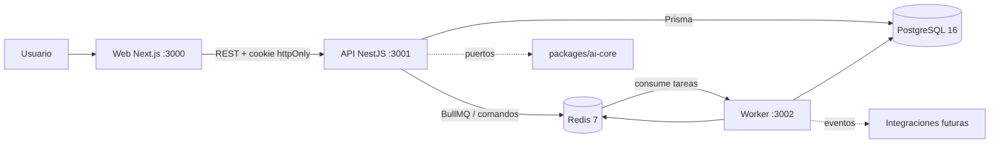
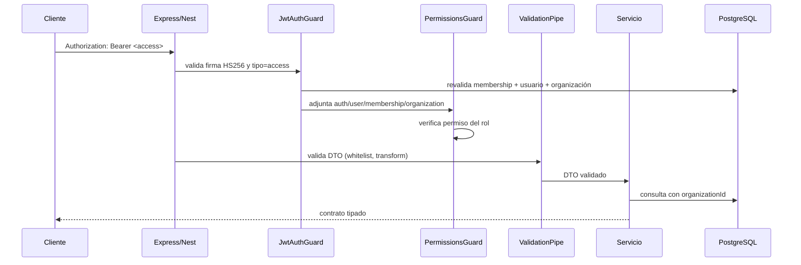
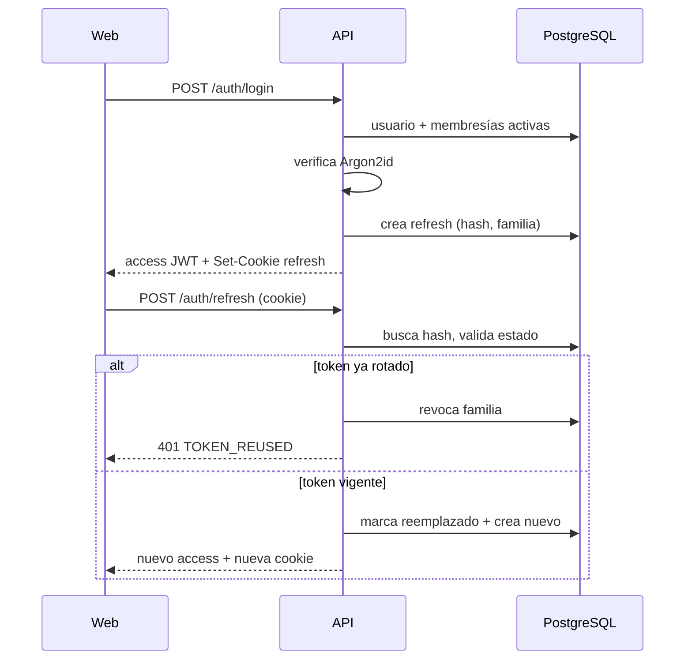
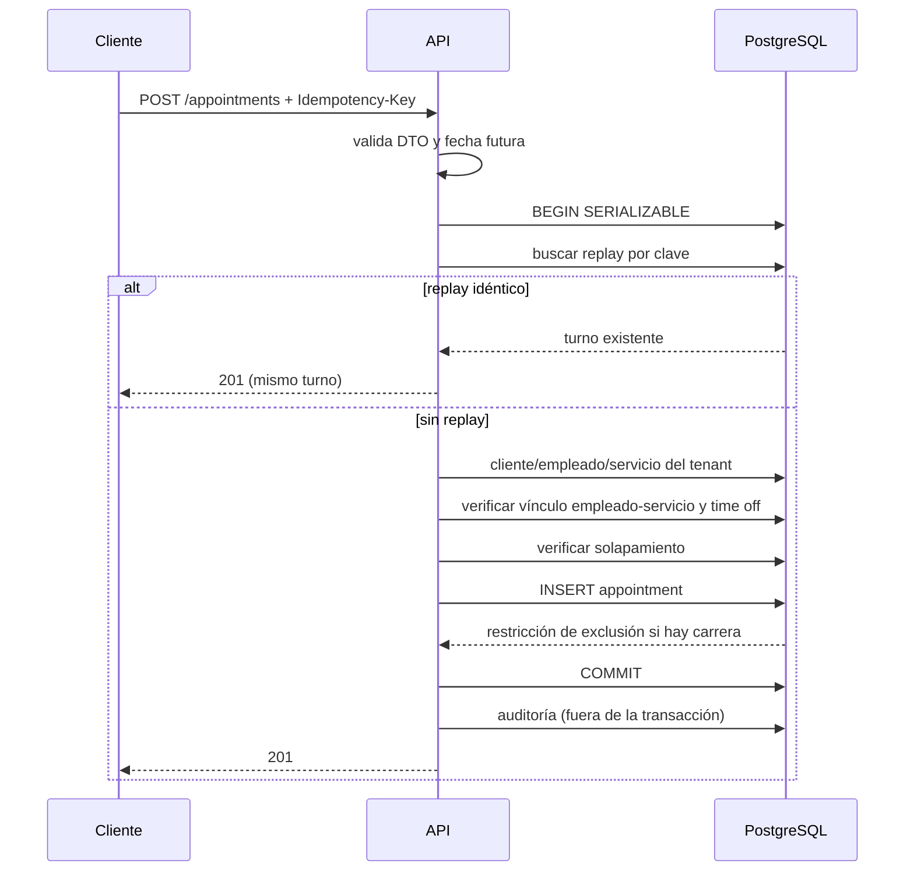

# Arquitectura

## 1. Contexto y alcance

TurnoPro es una plataforma SaaS multi-tenant para que negocios de servicios gestionen turnos, clientes, empleados y disponibilidad. Esta entrega implementa la **fundación ejecutable**:

- autenticación y sesiones;
- aislamiento por organización;
- autorización por permisos;
- motor de reservas consistente;
- trabajos asíncronos;
- interfaces de integración desacopladas.

No implementa todos los módulos de negocio ni integra proveedores externos reales (WhatsApp/OpenAI). Esas decisiones se documentan en [`ROADMAP.md`](ROADMAP.md).

## 2. Vista de alto nivel



La API es la **única** puerta de acceso a datos de negocio. El worker comparte el cliente Prisma pero ejecuta tareas de mantenimiento, no atiende HTTP de usuario. La web nunca habla con PostgreSQL ni con Redis.

## 3. Monorrepositorio

```
apps/api        NestJS: HTTP, autenticación, RBAC, reservas
apps/web        Next.js App Router: UI y cliente HTTP
apps/worker     BullMQ: limpieza programada y health server
packages/*      Código compartido y límites de dominio
```

### Dependencias entre paquetes

```mermaid
flowchart TD
  WEB[apps/web] --> UI[packages/ui]
  WEB --> CTR[packages/contracts]
  WEB --> SH[packages/shared]
  API[apps/api] --> DB[packages/database]
  API --> CTR
  API --> SH
  API --> AI[packages/ai-core]
  WORKER[apps/worker] --> DB
  WORKER --> SH
  AI --> SH
  DB --> PRISMA[@prisma/client]
```

Reglas:

- `packages/ui` se consume como código fuente y Next lo transpila.
- Los demás paquetes internos compilan a CommonJS en `dist/`.
- `packages/ai-core` sólo depende de `zod` y `@turnopro/shared`; no conoce Prisma ni NestJS.
- `packages/contracts` contiene tipos/schemas públicos, sin lógica de persistencia.

## 4. Ciclo de una petición HTTP



Componentes transversales:

| Componente | Archivo | Función |
| --- | --- | --- |
| `JwtAuthGuard` | `apps/api/src/common/guards` | Exige token salvo rutas `@Public()` |
| `PermissionsGuard` | `apps/api/src/common/guards` | Comprueba permisos declarados |
| `ValidationPipe` | `apps/api/src/app.setup.ts` | Whitelist, transformación y errores unificados |
| `AllExceptionsFilter` | `apps/api/src/common/filters` | Envuelve errores en `{ error: {...} }` |
| `AuditService` | `apps/api/src/modules/audit` | Registro de acciones sensibles |
| `nestjs-pino` | `apps/api/src/app.module.ts` | Logs JSON con redacción y request id |

Cada respuesta incorpora `X-Request-Id`, reutilizando el entrante si es válido o generando uno nuevo.

## 5. Autenticación y sesión

- **Contraseñas:** Argon2id mediante `@node-rs/argon2`.
- **Access token:** JWT HS256, 15 minutos por defecto, con `sub`, `org`, `mid`, `role` y `type: "access"`.
- **Refresh token:** valor opaco aleatorio; en base de datos sólo se guarda su hash SHA-256.
- **Transporte:** el refresh viaja en cookie `httpOnly`, `SameSite=Lax`, `path=/api/v1/auth`, `Secure` configurable.
- **Rotación:** cada refresh crea un token nuevo y marca el anterior como reemplazado.
- **Detección de reutilización:** si se presenta un token ya rotado, se revoca toda la familia y se responde `TOKEN_REUSED`.
- **Logout:** revoca la familia y limpia la cookie.
- **CSRF:** `refresh` y `logout` validan `Origin` contra `WEB_ORIGIN`; el access token viaja en cabecera, no en cookie.



Si el usuario pertenece a varias organizaciones y no envía `organizationSlug`, el login responde `409 ORGANIZATION_REQUIRED` con las opciones disponibles. El frontend muestra el selector.

## 6. Multi-tenancy

Modelo elegido: **esquema compartido con `organizationId`** en todas las tablas de negocio.

Capas de aislamiento:

1. **Token:** `org` identifica la organización activa.
2. **Guard:** en cada petición se consulta la membresía por `(userId, organizationId)` y se verifica que usuario, membresía y organización estén activos. No se confía en el contenido del JWT para autorizar.
3. **Servicio:** todas las consultas incluyen `organizationId`.
4. **Respuesta:** un recurso de otra organización responde `404`, evitando filtrar su existencia.
5. **Escritura:** antes de crear una reserva se verifica que cliente, empleado y servicio pertenezcan al tenant y que el empleado ofrezca el servicio.

Ventajas: una sola migración, menor coste operativo y consultas sencillas. Riesgo: una consulta sin filtro podría filtrar datos. Se mitiga con revisión, pruebas de aislamiento y convención obligatoria. Si el producto crece a clientes que exigen aislamiento físico, se puede migrar a esquema por tenant o base por tenant sin cambiar los contratos.

## 7. RBAC

La matriz estática vive en `packages/shared/src/rbac.ts`.

| Permiso | OWNER | ADMIN | MANAGER | STAFF |
| --- | :-: | :-: | :-: | :-: |
| `organization:read` | ✅ | ✅ | ✅ | ✅ |
| `organization:update` | ✅ | ✅ | — | — |
| `organization:delete` | ✅ | — | — | — |
| `members:read` | ✅ | ✅ | ✅ | — |
| `members:invite/update/remove` | ✅ | ✅ | — | — |
| `services:read` | ✅ | ✅ | ✅ | ✅ |
| `services:write` | ✅ | ✅ | ✅ | — |
| `employees:read` | ✅ | ✅ | ✅ | ✅ |
| `employees:write` | ✅ | ✅ | ✅ | — |
| `clients:read` | ✅ | ✅ | ✅ | ✅ |
| `clients:write` | ✅ | ✅ | ✅ | — |
| `appointments:read` | ✅ | ✅ | ✅ | ✅ |
| `appointments:write` | ✅ | ✅ | ✅ | ✅ |
| `reports:read` | ✅ | ✅ | ✅ | — |
| `audit:read` | ✅ | ✅ | — | — |
| `billing:manage` | ✅ | — | — | — |

`OWNER` recibe todos los permisos. La matriz es deliberadamente estática en esta etapa: es fácil de auditar y no requiere tablas adicionales. Cuando existan roles personalizados, se moverá a base de datos manteniendo la misma interfaz `hasPermission`.

## 8. Motor de reservas

### 8.1 Problema

Dos recepcionistas (o reintentos de red) pueden intentar reservar el mismo empleado a la misma hora. Un simple `SELECT` seguido de `INSERT` no es suficiente: ambas transacciones pueden leer "libre" antes de escribir.

### 8.2 Defensa en tres niveles

1. **Transacción `SERIALIZABLE` + reintentos** en la API. PostgreSQL detecta conflictos de serialización y la API reintenta hasta 3 veces con espera creciente.
2. **Restricción de exclusión GiST** en PostgreSQL:
   ```sql
   EXCLUDE USING gist (
     "employeeId" WITH =,
     tstzrange("blockedFromAt", "blockedUntilAt", '[)') WITH &&
   ) WHERE ("status" <> 'CANCELLED')
   ```
   Aunque la API tuviera un error, la base rechaza el solapamiento con `23P01`.
3. **Verificación explícita de solapamiento** dentro de la transacción, para devolver un error de dominio claro antes de llegar a la restricción.

### 8.3 Buffers

Cada servicio define `bufferBeforeMinutes` y `bufferAfterMinutes`. El turno visible ocupa `[startAt, endAt)`, pero el rango bloqueado es:

```
[ startAt - bufferBefore , endAt + bufferAfter )
```

Así, dos servicios consecutivos no se pisan por el tiempo de preparación.

### 8.4 Idempotencia

- Clave en `Idempotency-Key` (recomendado) o `idempotencyKey` en el cuerpo.
- Índice único `(organizationId, idempotencyKey)`.
- Si la clave ya existe con los mismos datos, se devuelve el turno original (replay).
- Si existe con datos distintos, `409 IDEMPOTENCY_CONFLICT`.
- La auditoría sólo se registra en la creación real, no en el replay.

### 8.5 Secuencia de creación



### 8.6 Cancelación

Cancelar cambia el estado a `CANCELLED` y registra `cancelledAt`. La restricción de exclusión sólo aplica a estados distintos de `CANCELLED`, por lo que el slot queda libre. La operación es idempotente: cancelar un turno ya cancelado devuelve el mismo recurso. Un turno `COMPLETED` no se puede cancelar.

## 9. Worker y asincronía

- Cola: `turnopro-maintenance`.
- Scheduler BullMQ: `maintenance-cleanup`, intervalo configurable (60 min por defecto).
- Tareas actuales:
  - eliminar refresh tokens expirados hace más de 7 días;
  - eliminar eventos de outbox procesados hace más de 30 días.
- Health server independiente en `WORKER_HEALTH_PORT` (3002) con `/health/live` y `/health/ready`.
- Cierre ordenado ante `SIGINT`/`SIGTERM`.

La tabla `outbox_events` está preparada para publicar eventos de integración de forma transaccional. Aún no hay consumidores externos.

## 10. Integraciones y IA

`packages/ai-core` define:

- `AssistantProvider`: puerto para un proveedor de LLM.
- `ToolDefinition` / `ToolRegistry`: herramientas con esquema Zod, permisos requeridos y ejecución tipada.
- `ToolContext`: organización, actor y rol obligatorios.

El LLM **nunca** recibe acceso a Prisma ni a la base de datos. Sólo puede invocar herramientas registradas, que a su vez deben pasar por servicios de la API y respetar el tenant. No hay implementación de OpenAI ni de WhatsApp en esta etapa; agregar una integración requiere un adaptador explícito y pruebas de autorización.

## 11. Observabilidad

- Logs JSON con `pino`; se redactan cookies, autorización y contraseñas.
- `X-Request-Id` propagado a logs y respuestas.
- `/health/live`: proceso HTTP vivo.
- `/health/ready`: PostgreSQL y Redis disponibles; responde `503` si falta una dependencia.
- Worker con health propio y logs JSON por trabajo.
- Auditoría de negocio en `audit_logs` para creación/cancelación de turnos y cambios de organización.

## 12. Despliegue local con Docker

`infrastructure/Dockerfile` usa etapas:

| Etapa | Contenido |
| --- | --- |
| `base` | Node 22, Corepack, pnpm, OpenSSL |
| `deps` | Instalación con lockfile congelado |
| `builder` | Prisma generate + build de todo el workspace |
| `runtime` | Workspace compilado, usuario `node` |
| `api` / `worker` / `web` | Comandos de arranque por servicio |

`infrastructure/docker-compose.yml` orquesta:

```
postgres (healthy) → migrate (exit 0) → api (healthy) → web
                            ↘ worker
redis (healthy) ─────────────┘
```

Puntos importantes:

- `migrate` ejecuta `prisma migrate deploy` y debe terminar antes de API/worker.
- El build de la web recibe `NEXT_PUBLIC_API_URL` como build arg porque Next la inlinea.
- `JWT_ACCESS_SECRET` debe sobrescribirse; el valor por defecto es sólo para desarrollo.
- Los volúmenes `postgres-data` y `redis-data` conservan estado.
- **No se ejecutó Docker en el entorno de construcción.** El Compose se validó estáticamente; ejecútalo en tu máquina antes de desplegar.

## 13. Decisiones y alternativas descartadas

| Decisión | Alternativa descartada | Motivo |
| --- | --- | --- |
| Esquema compartido con `organizationId` | Base/esquema por tenant | Simplicidad operativa para la etapa; migración posible después |
| JWT corto + refresh opaco rotativo | Sólo JWT largo | Permite revocación real y detección de robo |
| Cookie httpOnly para refresh | Refresh en localStorage | Reduce exposición a XSS |
| Revalidar membresía en cada petición | Confiar sólo en el JWT | Un usuario suspendido pierde acceso de inmediato |
| Transacción serializable + exclusión GiST | Sólo validación en aplicación | La base es la última línea de defensa ante carreras |
| Idempotencia en base de datos | Caché en memoria/Redis | Persistente y consistente entre réplicas |
| Worker separado | Tareas dentro de la API | Evita acoplar latencia y ciclo de vida |
| `ai-core` como puertos | Llamadas directas a OpenAI desde controladores | Mantiene el dominio testeable y sin acceso a datos |

## 14. Límites actuales

- Rate limiting en memoria: no coordinado entre réplicas.
- Sin UI de agenda todavía.
- Sin envío real de correos ni invitaciones.
- Sin consumidores de outbox.
- Sin pruebas de carga formales.
- Docker no verificado en ejecución local.

El siguiente paso recomendado es el módulo de agenda y disponibilidad, descrito en [`ROADMAP.md`](ROADMAP.md).
