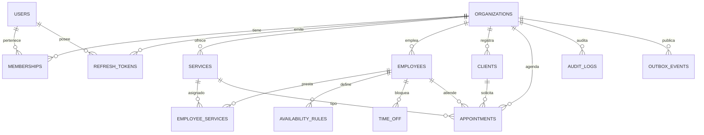

# Base de datos

Motor: **PostgreSQL 16**. ORM: **Prisma 6.19**. Esquema: `public`.

## 1. Modelo multi-tenant

Todas las tablas de negocio incluyen `organizationId` con FK a `organizations`. La organización activa siempre proviene del token y se revalida en la API; la base no adivina el tenant.



## 2. Tablas

### Acceso y organizaciones

| Tabla | Propósito | Restricciones relevantes |
| --- | --- | --- |
| `organizations` | Tenant raíz | `slug` único y validado por regex; nombre no vacío |
| `users` | Identidad global | `email` único y en minúsculas |
| `memberships` | Rol de un usuario en una organización | único `(organizationId, userId)` |
| `refresh_tokens` | Sesiones rotativas | `tokenHash` único; familia para detección de reuso |

### Catálogo y disponibilidad

| Tabla | Propósito | Restricciones relevantes |
| --- | --- | --- |
| `services` | Servicio reservable | único `(organizationId, name)`; duración > 0; buffers y precio ≥ 0 |
| `employees` | Persona que atiende | índices por tenant y estado |
| `employee_services` | Qué empleado ofrece qué servicio | único `(employeeId, serviceId)` |
| `availability_rules` | Horario semanal por empleado | `weekday` 0–6; minutos válidos y `endMinute > startMinute` |
| `time_off` | Bloqueos puntuales | `endsAt > startsAt` |
| `clients` | Cliente del negocio | único `(organizationId, phone)` (teléfono puede ser nulo) |

### Reservas y procesos

| Tabla | Propósito | Restricciones relevantes |
| --- | --- | --- |
| `appointments` | Turno reservado | rangos válidos; idempotencia única por tenant; exclusión GiST por empleado |
| `audit_logs` | Trazabilidad de acciones | índices por tenant/fecha y entidad |
| `outbox_events` | Eventos para integraciones futuras | estado, intentos y disponibilidad |

## 3. Enums

| Enum | Valores |
| --- | --- |
| `OrganizationStatus` | `ACTIVE`, `SUSPENDED`, `CLOSED` |
| `UserStatus` | `ACTIVE`, `DISABLED` |
| `MembershipRole` | `OWNER`, `ADMIN`, `MANAGER`, `STAFF` |
| `MembershipStatus` | `ACTIVE`, `INVITED`, `SUSPENDED` |
| `ServiceStatus` | `ACTIVE`, `ARCHIVED` |
| `EmployeeStatus` | `ACTIVE`, `INACTIVE` |
| `ClientStatus` | `ACTIVE`, `ARCHIVED` |
| `AppointmentStatus` | `PENDING`, `CONFIRMED`, `COMPLETED`, `CANCELLED`, `NO_SHOW` |
| `OutboxStatus` | `PENDING`, `PROCESSING`, `PROCESSED`, `FAILED` |

## 4. El modelo `Appointment`

```prisma
model Appointment {
  id                String            @id @default(uuid()) @db.Uuid
  organizationId    String            @db.Uuid
  clientId          String            @db.Uuid
  employeeId        String            @db.Uuid
  serviceId         String            @db.Uuid
  startAt           DateTime          @db.Timestamptz(3)
  endAt             DateTime          @db.Timestamptz(3)
  blockedFromAt     DateTime          @db.Timestamptz(3)
  blockedUntilAt    DateTime          @db.Timestamptz(3)
  status            AppointmentStatus @default(PENDING)
  idempotencyKey    String?           @db.VarChar(128)
  notes             String?           @db.Text
  createdByUserId   String?           @db.Uuid
  cancelledAt       DateTime?         @db.Timestamptz(3)
  cancellationReason String?          @db.VarChar(240)
  createdAt         DateTime          @default(now()) @db.Timestamptz(3)
  updatedAt         DateTime          @updatedAt @db.Timestamptz(3)
}
```

### Por qué hay cuatro fechas

- `startAt` / `endAt`: lo que ve el usuario y ocupa el servicio.
- `blockedFromAt` / `blockedUntilAt`: rango real que impide reservar, incluyendo buffers del servicio.

Los buffers se calculan al crear el turno y se **congelan** en el registro. Si mañana cambia la duración del servicio, los turnos históricos conservan el rango con el que se reservaron.

### Restricciones SQL

Además de las validaciones de Prisma, la migración incluye:

```sql
CHECK (endAt > startAt)
CHECK (blockedUntilAt > blockedFromAt)
CHECK (blockedFromAt <= startAt AND blockedUntilAt >= endAt)
```

Y la defensa clave contra dobles reservas:

```sql
CREATE EXTENSION IF NOT EXISTS "btree_gist";

ALTER TABLE appointments
  ADD CONSTRAINT appointments_employee_blocked_excl
  EXCLUDE USING gist (
    employeeId WITH =,
    tstzrange(blockedFromAt, blockedUntilAt, '[)') WITH &&
  )
  WHERE (status <> 'CANCELLED');
```

Notas:

- `[)` significa inicio inclusivo y fin exclusivo: un turno que termina a las 10:00 permite otro que empieza a las 10:00.
- `WHERE status <> 'CANCELLED'` libera el slot al cancelar.
- La restricción es por empleado, no por organización, porque un empleado pertenece a una sola organización.
- Requiere la extensión `btree_gist` para combinar igualdad y rango en un índice GiST.

### Idempotencia

```sql
CREATE UNIQUE INDEX appointments_organizationId_idempotencyKey_key
  ON appointments (organizationId, idempotencyKey);
```

En PostgreSQL los valores `NULL` no colisionan, por lo que los turnos sin clave pueden coexistir. La API normaliza la clave vacía a `NULL`.

## 5. Índices pensados para consultas reales

| Índice | Consulta que sirve |
| --- | --- |
| `appointments(organizationId, startAt)` | Agenda del tenant por fecha |
| `appointments(organizationId, status, startAt)` | Filtro por estado y fecha |
| `appointments(employeeId, startAt, endAt)` | Búsqueda de solapamientos |
| `appointments(clientId, startAt)` | Historial de un cliente |
| `memberships(userId, status)` | Organizaciones activas de un usuario |
| `refresh_tokens(familyId)` | Revocación de familia |
| `refresh_tokens(expiresAt)` | Limpieza programada |
| `audit_logs(organizationId, createdAt)` | Actividad reciente del tenant |
| `outbox_events(status, availableAt)` | Cola de eventos pendientes |

## 6. Migraciones

Ubicación: `packages/database/prisma/migrations/`.

Migración actual:

```
20261104000000_init/
└── migration.sql
```

Incluye la extensión `btree_gist`, enums, tablas, FKs, índices, checks y la restricción de exclusión.

### Flujo normal

```bash
pnpm db:generate     # regenera el cliente
pnpm db:migrate      # crea y aplica una migración en desarrollo
pnpm db:deploy       # aplica migraciones pendientes en producción
pnpm db:seed         # datos ficticios
```

Reglas:

- No edites una migración ya aplicada en un entorno compartido.
- Revisa el SQL generado antes de commitear; Prisma no siempre expresa checks ni exclusiones.
- Si agregas una restricción avanzada, escríbela en SQL y documéntala aquí.

### Workaround en entornos restringidos

Si el schema engine de Prisma no puede comunicarse con su proceso auxiliar:

```bash
psql "$DATABASE_URL" -v ON_ERROR_STOP=1 -f prisma/migrations/20261104000000_init/migration.sql
pnpm exec prisma migrate resolve --applied 20261104000000_init
```

Esto sólo aplica cuando el SQL ya se ejecutó; no sustituye el flujo normal.

## 7. Seed

Archivo: `packages/database/prisma/seed.ts`.

Crea de forma idempotente:

- organización `demo` (`TurnoPro Demo`);
- usuario `owner@demo.turnopro.local` con contraseña ficticia;
- membresía `OWNER`;
- servicio “Consulta general” (30 min, buffers de 5 min);
- empleada ficticia “Ana López (demo)”;
- vínculo empleada-servicio;
- disponibilidad de lunes a viernes de 09:00 a 18:00;
- cliente ficticio “Cliente Demo”;
- seis turnos de demostración relativos a la fecha actual (pasados y futuros,
  con estados `CONFIRMED`, `PENDING`, `COMPLETED`, `NO_SHOW` y `CANCELLED`),
  identificados por `idempotencyKey` (`seed-demo-01` … `seed-demo-06`) y sin
  solapamientos para respetar la restricción de exclusión.

Todos los datos son inventados y sólo existen en desarrollo. El seed puede ejecutarse varias veces sin duplicar registros. El comando respeta `NODE_ENV`: con `NODE_ENV=production` se niega a ejecutarse.

## 8. Consultas y transacciones

- La API usa `PrismaService` con cierre ordenado en `onModuleDestroy`.
- La creación de turnos usa `Prisma.TransactionIsolationLevel.Serializable`.
- Los reintentos sólo cubren errores de serialización; no se reintentan errores de validación ni de negocio.
- Las lecturas de agenda usan `count` + `findMany` en una transacción de lectura para mantener coherencia de paginación.

## 9. Copias de seguridad y operación

- En Docker, los datos viven en el volumen `postgres-data`.
- Para producción, configura backups automáticos y pruebas de restauración.
- `refresh_tokens` y `outbox_events` crecen con el tiempo; el worker elimina registros antiguos.
- Las migraciones deben ejecutarse como paso previo al despliegue (`migrate` en Compose).

## 10. Evolución prevista

1. Agregar índices parciales para agenda por estado si el volumen lo exige.
2. Mover roles personalizados a tablas manteniendo la matriz base.
3. Añadir `deletedAt` sólo donde la normativa lo requiera; hoy se usa estado (`ARCHIVED`).
4. Evaluar particionado de `appointments` por fecha si supera millones de filas.
5. Añadir políticas RLS de PostgreSQL como defensa adicional si el equipo crece.
